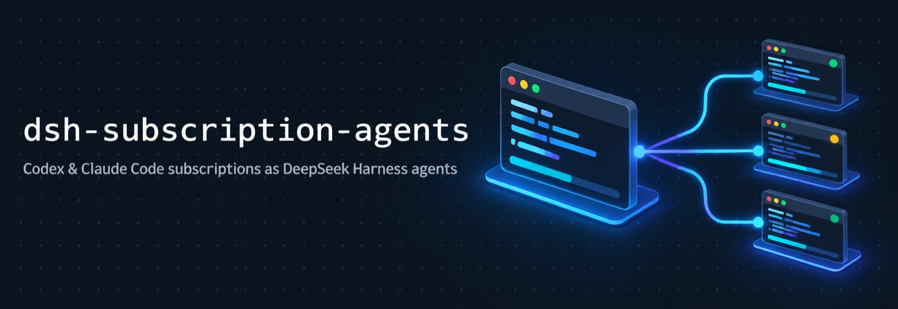
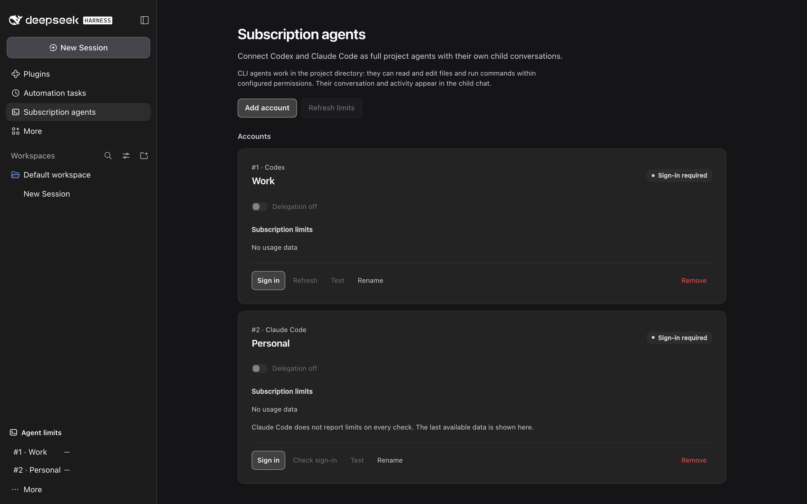
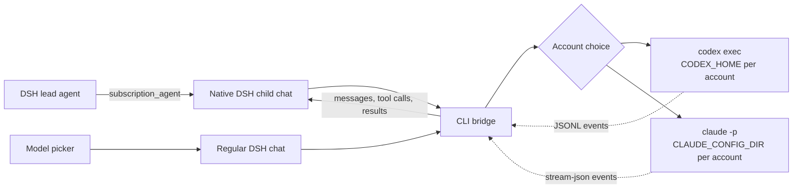

<p align="center">
  
</p>

<p align="center">
  <a href="https://github.com/adsqwui/dsh-subscription-agents/actions/workflows/test.yml"></a>
  <a href="https://www.npmjs.com/package/dsh-subscription-agents"></a>
  
  
  
  <a href="LICENSE"></a>
  <a href="CONTRIBUTING.md"></a>
</p>

<p align="center">
  Run the official <b>Codex</b> and <b>Claude Code</b> CLIs on your own subscriptions as models and continuable child agents inside <a href="https://github.com/deepseek-ai/deepseek-harness">DeepSeek Harness</a>.
</p>

---

<p align="center">
  
</p>

## Why

You already pay for ChatGPT or Claude. DeepSeek Harness is a good place to run agents. This plugin connects the two without API keys, proxies or patched binaries. It drives the **unmodified** official CLIs you installed yourself, gives each account its own isolated profile, and shows their work as ordinary DSH chats you can read, continue and interrupt.

## Features

- **Accounts panel.** Add Codex and Claude Code accounts, sign in through the vendor's own browser flow, run a one-word smoke test, then switch delegation on. Rename, refresh, sign out and remove from the same card.
- **Subscriptions in the model picker.** Every tested account is its own provider in the picker (and in `/model`), with the models its CLI lists: Opus, Sonnet, Haiku and Fable for Claude Code, the GPT models your Codex version offers. Pick one, or let the CLI default stand.
- **Token usage like any other model.** After each turn the plugin hands DSH the token counts the CLI reported (input, cached input, output), so usage stats and themes count subscription turns under the real model id.
- **Real child agents.** The `subscription_agent` tool starts a native, continuable DSH child chat and returns its name at once. The lead can pass `model` to pick one of the account's models (the `list` action shows them); without it the child runs on the account's default model. The lead gets a completion notice; `send_message` resumes the same account and vendor thread.
- **Full transcript.** Child chats show the delegated prompt, every finished assistant message and the CLI's tool calls with their results. Nothing is invented: hidden reasoning and nested vendor agents are not faked.
- **Nested sidebar.** Child chats fold under their parent in the workspace sidebar.
- **Quota you can see.** Codex limit windows come from the Codex App Server; Claude Code windows come from its stream events. The tightest fresh window decides which account has the most headroom.
- **Agent limits at a glance.** A compact list of every account and its current limit sits at the bottom of the left sidebar.
- **Images.** Both routes tell DSH they accept images, so you can paste a screenshot into a subscription chat or a child task. Codex gets it through `--image`, Claude Code inside its stream-json input.
- **Fails closed.** Restricted sessions, unknown DSH versions, missing CLIs and quota errors stop the task with a clear message instead of quietly doing something else.

## How it works



The bridge starts one CLI turn per DSH turn, reads its JSON event stream with bounded buffers, and writes the messages and tool activity into the DSH session. Each child chat pins one account and one vendor thread, so follow-ups continue the same conversation on the vendor side. Regular chats pass recent visible text to a fresh CLI turn instead, which is what lets you switch accounts or providers mid-conversation.

## Requirements

| | |
|---|---|
| DeepSeek Harness | Desktop **0.2.2-rc.3** or any later **0.2.x**. The manifest declares `engines.dsh: ">=0.2.2-rc.3 <0.3.0-0"`. |
| OS | macOS |
| CLIs | Official `codex` and/or `claude`, already installed and on `PATH` (`~/.local/bin`, `/opt/homebrew/bin`, `/usr/local/bin` are searched) |
| Session | **Full access** for agent work and subscription chats |

## Install

In DSH open **Plugins → Add plugin**, enter the package name and install:

```text
dsh-subscription-agents
```

Enable it, then fully restart Desktop: the nested sidebar replaces the shipped one, and that only happens on restart. From a terminal the same is `dsh plugin --profile <profile> add dsh-subscription-agents`.

To work on the code instead, clone the repository and give **Add plugin** the absolute path of the folder. DSH links to it, so `git pull` and a restart are all an update takes.

## Usage

### Connect an account

1. Open **Subscription agents** in the left sidebar and press **Add account**.
2. Pick Codex or Claude Code and give it a local name.
3. Press **Sign in** and finish the vendor's flow in your browser. If no browser opens, use the sign-in link the card shows.
4. The plugin runs one minimal "OK" request. **Test** repeats it at any time.
5. Switch **Delegation** on. Switching it off later stops new tasks and cancels a running one where possible.

**Remove** also asks the CLI to sign out locally. It does not revoke the vendor's browser session.

### Chat with a subscription

Open the model picker or `/model`, find **Codex · подписка · &lt;name&gt;** or **Claude Code · подписка · &lt;name&gt;**, and pick a model under it. The list comes from the CLI itself (Claude Code's initialize response, Codex's `model/list`), refreshes when you press **Test** or **Refresh**, and otherwise every six hours. A newer Codex CLI lists newer models. The conversation runs through that account only. If its CLI is missing or out of quota, the turn fails; the plugin never falls back to another route or reads API keys. Images in your message go to the CLI with it (PNG, JPEG, GIF or WebP, up to 20, scaled to 2000 px on the long side); other file attachments are not supported yet. See the [model picker spec](spec/subscription-model-picker.md).

### Delegate work

Ask the lead agent to hand a task off, or let it call `subscription_agent` itself:

```text
Delegate to a Claude Code subscription agent: add tests for src/parser.ts
and fix whatever they catch. You own src/parser.ts and its tests only.
```

The child chat appears under its parent. Open it to watch progress or to send a follow-up. For parallel work, give independent tasks to separate children: each Codex process works on its own, with nested Codex agents turned off. See the [delegation spec](spec/agent-delegation.md).

## Safety and permissions

- **Full access only.** CLI permissions cannot reproduce DSH's filesystem confinement, so restricted sessions are refused instead of being quietly widened.
- **Full access means the whole computer.** In a Full access session the CLI gets the same reach as DSH itself: Codex runs with `danger-full-access` and no approval prompts, Claude Code with `bypassPermissions`. Agents start in the session's working folder but can read, change and run anything your user account can. Only use it with tasks and accounts you trust.
- **Isolated credentials.** Codex accounts use their own `CODEX_HOME` with CLI-managed file auth. Claude Code accounts use their own `CLAUDE_CONFIG_DIR` and the macOS Keychain where available. Your existing CLI profiles are never imported or touched. Do not copy or share the plugin's private state folder.
- **Recorded, not replayed.** Tool calls the CLI made are written into the transcript but are never executed again through DSH.
- **Guarded start.** On start the plugin checks every DSH Host method it uses. If an update renamed or removed one, it stops with an error naming it and registers nothing.

## Quota and account choice

Every minute the plugin refreshes quota for ready, idle Codex and Claude Code accounts through their CLIs. Claude Code supplies the snapshot through its prompt-free `get_usage` request on supported versions. A snapshot older than six minutes, or one past its reset time, no longer affects the choice. Among enabled accounts, the one with the most headroom in its tightest fresh window wins; accounts with unknown quota come after accounts with known headroom. A quota error is never retried on another account.

## Compatibility

The plugin accepts every DSH **0.2.x** release and refuses **0.3** until it has been checked against it. The nested sidebar in `workspace-ui/` is a patched build of DSH's MIT-licensed `ui-workspace` package from `dsh-v0.2.2-rc.3` (unchanged upstream through rc.5). To see whether a newer DSH changed it, run this in a DSH source checkout:

```bash
git diff --stat dsh-v0.2.2-rc.3 <new-tag> -- packages/client/ui-workspace/src
```

Empty output means the bundled sidebar is still current. Otherwise re-apply `workspace-ui/native-tree.patch` to the new source, rebuild with `workspace-ui/tsdown.config.ts` (it expects the DSH checkout at `../../deepseek-harness-src` relative to `workspace-ui`) and run `node workspace-ui/finalize-build.mjs`. Disabling the bundle always brings the stock sidebar back.

## Development

```bash
npm test
```

The suite runs on Node 22 and 24 on Linux and macOS in CI. It needs no DSH install and no CLI logins: the CLIs and the Host are replaced with fakes.

| File | What it does |
|---|---|
| `index.js` | Registers the panel API and the `subscription_agent` tool |
| `accounts.js` | Account store, sign-in, tests, quota and account choice |
| `cli.js` | Spawns the CLIs with isolated environments and parses their output |
| `agent-runner.js` | Runs one persistent CLI turn and normalizes its events |
| `native-bridge.js` | LLM adapter and subagent provider that write CLI turns into DSH sessions |
| `codex-usage.js` | Reads Codex limit windows from the App Server |
| `compat.js` | Checks the DSH Host API before anything registers |
| `client.js` | The accounts panel and the Agent limits list |
| `workspace-ui/` | The nested workspace sidebar |

## Contributing

Bug reports, ideas and pull requests are welcome. Read [CONTRIBUTING.md](CONTRIBUTING.md) first; it covers the setup, what a good PR looks like, and the few rules that keep accounts safe.

## Before you use it

Subscription plans from OpenAI and Anthropic are meant for a person using the vendor's own apps. Driving the official CLIs from another program, and especially spreading work over several subscriptions to stay under their limits, may break those vendors' terms, and accounts can be rate-limited or suspended for it. This project hides nothing from the vendors and will not help you get around a ban. Use it only with accounts you own, read the current terms yourself, and accept that the risk is yours.

References: [Codex non-interactive mode](https://learn.chatgpt.com/docs/non-interactive-mode) · [Codex App Server](https://developers.openai.com/codex/app-server) · [Claude Code authentication](https://code.claude.com/docs/en/authentication) · [Claude Code legal and compliance](https://code.claude.com/docs/en/legal-and-compliance#authentication-and-credential-use)

## License

[MIT](LICENSE). `workspace-ui/` contains code from DeepSeek Harness, also MIT; its notice is kept in [`workspace-ui/LICENSE`](workspace-ui/LICENSE). Not affiliated with DeepSeek, OpenAI or Anthropic.
